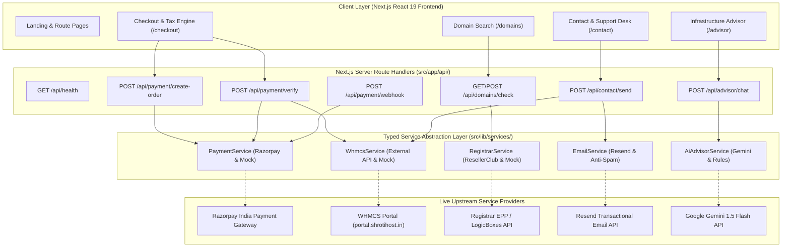
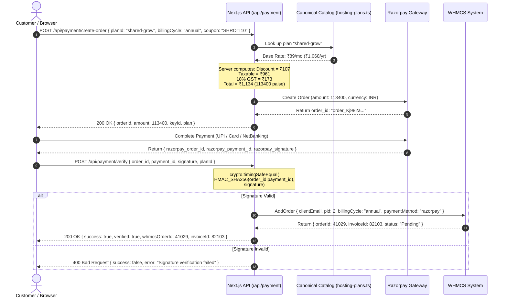
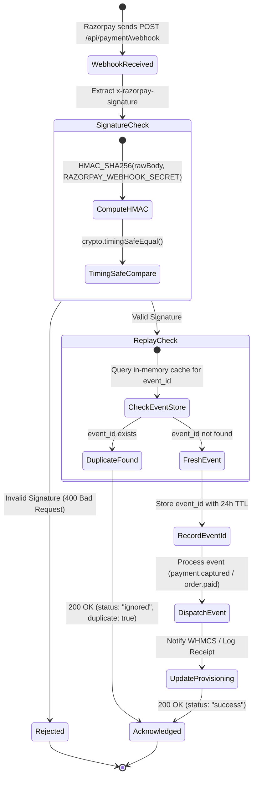

# ShrotiHost — Backend Architecture & Service Integration Specification

**Document Version:** 1.0.0  
**Status:** Production-Ready Service Abstraction & Server Route Handlers  
**Target Environment:** Node.js App Router (Next.js 16)  
**Security Standard:** OWASP Top 10 Compliant · Constant-Time HMAC SHA-256 · Replay-Protected  

---

## 1. Executive Architecture Summary

ShrotiHost operates as an enterprise-grade cloud hosting and infrastructure platform. To transition from a purely static presentation frontend to a fully operational commerce platform, this architecture establishes a clean, decoupled service layer with typed contracts, server-side Next.js Route Handlers (`src/app/api/`), cryptographic payment verification, automated WHMCS provisioning hand-off, domain registrar abstraction, and grounded AI consulting.

---

## 2. Core Service Boundaries

Each service in `src/lib/services/` implements a strict interface pattern with runtime provider switching:
1. **Production Mode:** Activated when production credentials are configured in `.env.local`.
2. **Mock / Development Mode:** Activated when credentials are absent or prefixed with `mock_`. Generates RFC-compliant identifiers and mimics provider behavior without requiring paid accounts or risk of accidental financial transactions.

| Service | File Path | Production Driver | Development / Mock Driver | Key Responsibilities |
| :--- | :--- | :--- | :--- | :--- |
| **Payment** | [`payment.ts`](file:///C:/Users/asara/.gemini/antigravity/scratch/shrotihost-redesign/src/lib/services/payment.ts) | Razorpay REST API | Cryptographic Mock Store | Server-enforced pricing, 18% GST calculation, HMAC signature validation, webhook replay deduplication |
| **WHMCS** | [`whmcs.ts`](file:///C:/Users/asara/.gemini/antigravity/scratch/shrotihost-redesign/src/lib/services/whmcs.ts) | WHMCS External API (`api.php`) | Typed Mock Provisioner | Automated order queueing, client registration, cPanel user generation, support ticket dispatch |
| **Registrar** | [`registrar.ts`](file:///C:/Users/asara/.gemini/antigravity/scratch/shrotihost-redesign/src/lib/services/registrar.ts) | ResellerClub / LogicBoxes | Canonical TLD Engine | RFC 1035 syntax validation, multi-TLD availability check, alternative extension suggestions |
| **Email** | [`email.ts`](file:///C:/Users/asara/.gemini/antigravity/scratch/shrotihost-redesign/src/lib/services/email.ts) | Resend API / SMTP | Mock Transactional Log | Honeypot bot protection, HTML sanitization against XSS, order confirmation dispatch |
| **AI Advisor** | [`ai-advisor.ts`](file:///C:/Users/asara/.gemini/antigravity/scratch/shrotihost-redesign/src/lib/services/ai-advisor.ts) | Google Gemini 1.5 Flash | Deterministic Rules Engine | Catalog-grounded infrastructure recommendations with guaranteed pricing and zero hallucinations |

---

## 3. End-to-End Order & Provisioning Sequence

The checkout flow enforces absolute server authority over pricing to make client-side price tampering impossible.

---

## 4. Razorpay Webhook Lifecycle & Replay Protection

Payment confirmation also flows asynchronously through Razorpay webhooks to handle instances where a user closes their browser before redirection.

---

## 5. Security & Isolation Controls

1. **Anti-Price Tampering:** The client cannot pass an `amount` parameter to `/api/payment/create-order`. The server derives the amount solely from the static plan registry (`src/data/hosting-plans.ts`), verifies coupon codes, and calculates statutory 18% GST.
2. **Timing Attack Immunity:** Signature comparisons are performed exclusively via `crypto.timingSafeEqual` over fixed-length UTF-8 buffers.
3. **Replay Attack Resistance:** Webhook event IDs are held in a TTL-bounded cache. Re-delivered webhooks receive an immediate `200 OK` acknowledgment without re-triggering provisioning.
4. **Honeypot Anti-Spam:** Public contact endpoints inspect an invisible `honeypot` field. Bot automated submissions are silently dropped without alerting the bot.
5. **Zero Secret Leakage:** All API keys (`RAZORPAY_KEY_SECRET`, `WHMCS_API_SECRET`, `RESEND_API_KEY`, `GEMINI_API_KEY`) are kept on the server. No secret environment variables use the `NEXT_PUBLIC_` prefix.
